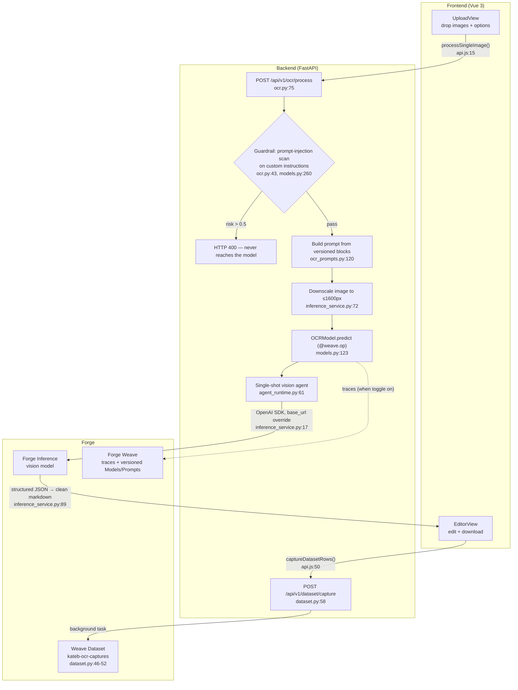

# Kateb architecture

A code-level tour of how a handwritten note becomes Markdown. For features and setup, see the [README](../README.md); this document is about *how the pieces fit*, with pointers into the code (`file:line`).

Kateb is two processes: a **Vue 3 frontend** (Vite, port 5173) and a **FastAPI backend** (port 8000). The backend calls **Forge Inference** (an OpenAI-compatible vision-LLM API) and, when the tracing toggle is on, records everything in **Forge Weave**.

## The workflow

The `/ocr/compare` route (`backend/routers/ocr.py:162`) is the same pipeline with a fan-out: `ComparisonModel.predict` (`backend/services/models.py:180`) runs two `OCRModel`s on the same image in parallel via `asyncio.gather`, so the user can pick the better transcription.

## Life of an OCR request

1. **Upload.** The user drops up to 5 images in `UploadView.vue` and picks options (LaTeX, diagrams, free-text custom instructions). Each image becomes its own `POST /api/v1/ocr/process` — they run in parallel (`frontend/src/views/UploadView.vue:58`).

2. **Guardrail.** The custom-instructions field is free text that gets concatenated into the prompt — a prompt-injection vector. Before anything else, `_enforce_guardrail` (`backend/routers/ocr.py:43`) runs LLM Guard's DeBERTa classifier, wrapped as `GuardrailModel` (`backend/services/models.py:247`). It's a local model (no network), loaded once per process behind a lock (`models.py:341`). A failed scan is an immediate HTTP 400; the vision model is never called.

3. **Prompt assembly.** `build_ocr_prompt` (`backend/prompts/ocr_prompts.py:120`) composes the prompt from four blocks — system prompt, optional LaTeX instructions, optional diagram instructions, output format — with the user's custom instructions appended last (static-first ordering is deliberate, for inference-side prompt-prefix caching). Each block is also a **versioned Weave prompt asset**: on startup `sync_prompts()` (`ocr_prompts.py:83`) publishes the local blocks as `weave.StringPrompt` objects and adopts whatever is `:latest` in the Weave project, so a prompt edit — in code or in the Weave UI — is tracked as a new version. If Weave is off or unreachable, the local constants serve as the fallback.

4. **Inference.** `OCRModel.predict` (`backend/services/models.py:123`) downscales the image to ≤1600px (`backend/services/inference_service.py:72`), then runs a single-shot OpenAI Agents SDK agent (`backend/services/agent_runtime.py:61`, `max_turns=1`) against Forge Inference — a standard `AsyncOpenAI` client with `base_url` pointed at `api.inference.wandb.ai/v1` (`inference_service.py:17`). Structured output is enforced with a strict JSON schema (`inference_service.py:55`) so the model returns `{markdown: ...}` instead of prose; non-conforming output degrades gracefully to raw text (`agent_runtime.py:33`). The result is cleaned of stray code fences (`inference_service.py:89`) and returned.

5. **Edit & download.** `EditorView.vue` renders a per-image Markdown editor with KaTeX preview. On download, if tracing is on, a modal offers to also capture `(image, edited_markdown, original_ocr)` rows to a Weave Dataset — a fire-and-forget POST handled in a FastAPI background task (`backend/routers/dataset.py:58`), appending to or creating `kateb-ocr-captures` (`dataset.py:46-52`).

## The Weave layer

Everything observable in Kateb hangs off three `weave.Model` subclasses in `backend/services/models.py` — `OCRModel` (:112), `ComparisonModel` (:171), `GuardrailModel` (:247). Their public Pydantic fields are their *version identity*: change `model_id`, a guardrail threshold, or a prompt version and the Weave Models tab shows a new version automatically. `postprocess_inputs` callbacks (`models.py:79-104`) control what lands in traces — image + options in, credentials and `self` stripped.

Tracing is **opt-in** and reconciled in one place, `backend/services/credentials.py`:

- `apply_tracing_setting()` (:137) — toggle off sets `WEAVE_DISABLED=true` (every `@weave.op` no-ops); toggle on runs `try_init_weave()`.
- `try_init_weave()` (:111) — calls `weave.init("{entity}/{project}")` (:123) when the API key, entity, and project are all present, then syncs the prompt assets (:131). Idempotent across credential re-saves.

This runs at startup (`backend/main.py:10`) and whenever credentials change via the gear-icon modal (`backend/routers/config.py:82`). Credentials live in a single `.env` file that the modal reads and writes — no restart needed.

Version-linking: each `OCRModel` instance is published as the `ocr-model` object (`models.py:289`) carrying `prompt_refs` — the exact prompt versions it used — so in the Weave UI you can click from a model version to the prompt text that produced its outputs.

## Where things live

| Area | Files |
| --- | --- |
| HTTP routes | `backend/routers/ocr.py` (process :75, compare :162), `config.py` (status :75, save :82), `dataset.py` (capture :58) |
| Models & tracing | `backend/services/models.py`, `backend/services/credentials.py` |
| Prompts (versioned) | `backend/prompts/ocr_prompts.py` (blocks :8–:62, sync :83, builder :120) |
| Inference plumbing | `backend/services/inference_service.py` (model registry :24), `backend/services/agent_runtime.py` |
| Model registry upkeep | `scripts/update_model_catalog.py` regenerates `AVAILABLE_MODELS` from the public Forge inference catalog; `.github/workflows/update-models.yml` runs it weekly and opens a PR |
| Frontend flow | `frontend/src/views/` (Upload → Editor → Compare), `frontend/src/services/api.js`, state in `frontend/src/stores/notes.js` |

> Line numbers are anchors into the current codebase; if the code has moved, grep for the named function instead.
